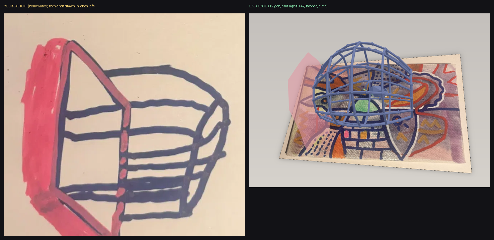

# AR Dome — artwork augment

Point your phone camera at the painting and a low-poly cask cage in the same blue
as the artwork's linework anchors to it in AR — a pink cloth thrown over one end,
and a low-poly cat chasing a mouse along the floor inside.

**Live:** https://edwin607.github.io/ar-dome/

## How it works
- [MindAR](https://github.com/hiukim/mind-ar) image tracking (three.js build, pinned to three@0.150.1) anchors the scene to the artwork.
- `artwork.mind.gz.*` — the compiled image target, gzipped and chunked; the page reassembles and decompresses it in-browser (`DecompressionStream`, pako fallback).
- The cage's members are tubes matching the painting's stroke weight, in the sampled linework blue (`#2a3670`); the cloth is the pink from the artist's sketch (`#c0505f`).
- Every cage parameter can be overridden from the URL while art-directing, e.g. `?yaw=1.5708&length=0.42&radius=0.18` — useful on a phone next to the painting.
- Camera + HTTPS required — open on a phone for AR. Camera denied (or desktop) → orbit-controls preview against the artwork.
- `?debug=1` draws the tracked target frame and the anchor axes, so a misalignment can be diagnosed on-device.

## Anchored coordinate space

MindAR's anchor is `poseMatrix * translate(w/2, h/2, 0) * scale(w)`, so in
anchor-local space, origin at the target image centre, one unit = target image
**width**:

```
+x = right     +y = up the image     +z = out of the painting
```

The artwork therefore lies in the anchor's **XY** plane, not XZ. The scene is
authored y-up (footprint in XZ, height on +Y) so the orbit preview is natural,
and `toAnchorSpace()` rotates it by +90° about X for AR. Building the footprint
in XZ and the height on +y — as an earlier revision did — makes the whole
structure *lie flat on the painting* while tracking still looks perfect. That was
the "not aligning" bug. See SKILL.md for the full write-up.

## The cage (from the artist's sketch)

Measuring the sketch's ink in the reference photo, as vertical extent per column:
**245px at the near end, 415px at mid-length, 170px at the far end.** The belly is
the widest point and *both* ends draw in — so this is a cask, not a cone and not a
cylinder. The far end reads smaller still because it is further away.

A **12-sided section is what yields exactly 7 distinct member levels** under
projection (cos 15/45/75°), and the sketch shows ~7, so the cage is a 12-gon cask:
12 longitudinal rails over a barrel profile, hooped along its length, resting on
its belly, with a pink cloth thrown over the near end.

| parameter | value | note |
|---|---|---|
| `length` | `0.50` | along the axis, in painting widths |
| `radius` | `0.215` | section circumradius at the belly |
| `endTaper` | `0.42` | ends sit at 0.58 of the belly radius |
| `sides` | `12` | gives the sketch's ~7 member levels |
| `stroke` | `0.0058` | member radius — matches the painting's line weight |
| `yaw` | `0` | `0` = axis across the painting, `PI/2` = axis into it |
| `drapeFlare` / `drapeSag` | `1.22` / `0.080` | cloth over the near end |

Every parameter is overridable from the URL, so the shape can be tuned on a phone
next to the painting: `?yaw=1.5708&length=0.42&radius=0.19&endTaper=0.5`.



The earlier build was an octagonal hip-roofed gazebo matched to an AI-generated
render. That render is a good guide to look but not to measurement: its eight
post feet do not agree on a single ground ring (their implied ring centres differ
by more than the ring radius). The sketch supersedes it.

## Repository layout
- `index.html` — the whole AR experience (single file, CDN dependencies)
- `artwork.mind.gz.aa–ad` + `artwork.mind.manifest.json` — chunked image target
- `artwork-target.jpg.aa–ac` — chunked artwork photo (preview fallback ground plane)
- `tools/` — the pipeline: compile a new target, chunk binaries, smoke-test the page, alignment regression test
- `SKILL.md` — full pipeline documentation (ar-image-augment agent skill)

## Retargeting to a new image
1. Crop the new artwork photo tight to its edges, ≤ ~900px long side → `artwork-target.jpg`
2. `uv run --with playwright python tools/compile_target.py artwork-target.jpg --out artwork.mind`
3. `gzip -9 -c artwork.mind > artwork.mind.gz && python tools/chunk.py artwork.mind.gz artwork.mind.gz --manifest artwork.mind.manifest.json`
4. Re-chunk the jpg: `python tools/chunk.py artwork-target.jpg artwork-target.jpg`
5. Resize the scene to the new aspect: the painting spans `1.0 x (h/w)`, and the scene root stays at the anchor origin
6. `uv run --with playwright python tools/smoke_test.py <url> --deny-camera` — require `errors: none`
7. `uv run --with playwright --with pillow --with numpy --with opencv-python-headless python tools/align_test.py <url>` — require `RESULT: PASS`
